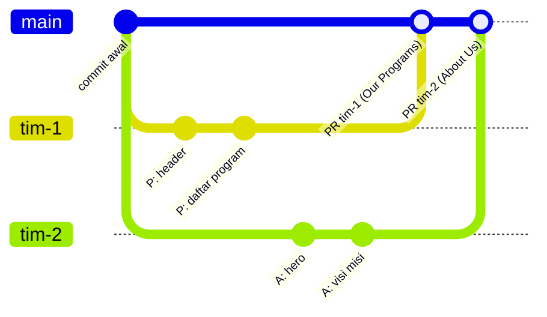

# Panduan Regenerasi 8EH Radio ITB 2026


---

## Daftar isi

1. [Kondisi awal halaman](#1-kondisi-awal-halaman)
2. [Menyiapkan proyek](#2-menyiapkan-proyek)
3. [Collaborator GitHub](#3-collaborator-github)
4. [Alur branch tim-1 dan tim-2](#4-alur-branch-tim-1-dan-tim-2)
5. [Kenapa harus JSX, bukan HTML?](#5-kenapa-harus-jsx-bukan-html)
6. [Mengubah HTML + CSS menjadi JSX](#6-mengubah-html--css-menjadi-jsx)
7. [Tiga cara styling tanpa Tailwind](#7-tiga-cara-styling-tanpa-tailwind)
8. [Contoh satu kotak](#8-contoh-satu-kotak)
9. [Kesalahan umum](#9-kesalahan-umum)
10. [Selector CSS](#10-selector-css)
11. [Ukuran box (x dan y)](#11-ukuran-box-x-dan-y)
12. [Gradasi warna](#12-gradasi-warna)
13. [Efek hover](#13-efek-hover)
14. [Font](#14-font)
15. [Gambar](#15-gambar)
16. [Ringkasan cepat](#16-ringkasan-cepat)

---

## 1. Kondisi awal halaman

Kedua halaman sudah dikosongkan dan tinggal kerangka:

| Halaman | File | Dikerjakan oleh | Alamat lokal |
|---|---|---|---|
| Our Programs | `app/programs/page.jsx` | tim-1 | http://localhost:3000/programs |
| About Us | `app/about-us/page.jsx` | tim-2 | http://localhost:3000/about-us |

Isi awal setiap file kurang lebih seperti ini:

```jsx
import Navbar from "@/app/components/Navbar";
import FooterSection from "@/app/components/FooterSection";

export default function AboutUsPage() {
  return (
    <div className="min-h-screen bg-white">
      <Navbar />

      {/* TODO: Bangun ulang halaman "About Us" di sini. */}
      <section className="min-h-screen" />

      <FooterSection />
    </div>
  );
}
```

Tugas kalian adalah mengganti `<section className="min-h-screen" />` dengan isi halaman.

> Komponen `ProgramsHeader.jsx` dan `ProgramsSlider.jsx` di `app/components/` **bukan** sisa halaman Our Programs. Keduanya masih dipakai di beranda dan halaman podcast, jadi **jangan dihapus**.

---

## 2. Menyiapkan proyek

### Alat yang dibutuhkan

- Git
- Bun (https://bun.sh)
- VS Code atau editor lain

### Clone dan jalankan

```bash
git clone https://github.com/atarmdhnn/regenerasi8ehradioitb2026.git
cd regenerasi8ehradioitb2026
bun install
bun dev
```

Buka http://localhost:3000/programs atau http://localhost:3000/about-us. Setiap kali file disimpan, browser akan ter-update otomatis. Tekan `Ctrl + C` di terminal untuk menghentikan server.

> Pakai **bun** saja. Jangan pakai `npm install`, karena proyek ini mengunci versi paket di `bun.lock`.

### Masalah: `zsh: command not found: bun`

Biasanya bun sudah terpasang di `~/.bun/bin`, tapi folder itu belum masuk `PATH`. Perbaiki dengan:

```bash
echo 'export BUN_INSTALL="$HOME/.bun"' >> ~/.zshrc
echo 'export PATH="$BUN_INSTALL/bin:$PATH"' >> ~/.zshrc
source ~/.zshrc
bun --version
```

Kalau hanya ingin cepat tanpa mengubah konfigurasi, jalankan `~/.bun/bin/bun install`.

---

## 3. Collaborator GitHub

Hanya pemilik repo yang bisa menambahkan anggota.

### Lewat website

1. Buka https://github.com/atarmdhnn/regenerasi8ehradioitb2026/settings/access
2. Klik **Add people**.
3. Masukkan username atau email GitHub anggota, lalu klik **Add … to this repository**.
4. Anggota harus **menerima undangan** lewat email atau https://github.com/notifications.

### Lewat terminal (`gh`)

```bash
gh api -X PUT repos/atarmdhnn/regenerasi8ehradioitb2026/collaborators/USERNAME_TEMAN -f permission=push
```

### Melindungi `main` (disarankan)

Di repo pribadi, semua collaborator bisa push langsung ke `main`. Agar perubahan wajib lewat pull request, buka **Settings**, lalu **Branches** (atau **Rules**), tambahkan aturan untuk `main`, dan centang **Require a pull request before merging**.

---

## 4. Alur branch tim-1 dan tim-2



| Branch | Fungsi |
|---|---|
| `main` | Kode final yang stabil. **Jangan commit langsung ke sini.** |
| `tim-1` | Bercabang dari `main` untuk mengerjakan **Our Programs**. |
| `tim-2` | Bercabang dari `main` untuk mengerjakan **About Us**. |
| Pull request | Titik akhir pekerjaan tim. Perubahan masuk ke `main` hanya setelah PR di-review. |

### Langkah tim-1 (Our Programs)

```bash
# 1. Ambil main terbaru
git checkout main
git pull

# 2. Buat branch tim (cukup sekali, oleh ketua tim)
git checkout -b tim-1
git push -u origin tim-1

# 3. Anggota lain cukup pindah ke branch itu
git fetch
git checkout tim-1

# 4. Kerjakan app/programs/page.jsx, lalu commit
git add app/programs
git commit -m "Our Programs: header"

# 5. Sebelum push, ambil dulu perubahan teman setim
git pull

# 6. Push
git push

# 7. Setelah selesai, buka pull request ke main
gh pr create --base main --head tim-1 --title "Halaman Our Programs"
```

### Langkah tim-2 (About Us)

Langkahnya sama, hanya nama branch diganti `tim-2` dan yang dikerjakan `app/about-us`:

```bash
git checkout main && git pull
git checkout -b tim-2
git push -u origin tim-2

git add app/about-us
git commit -m "About Us: hero"
git pull
git push

gh pr create --base main --head tim-2 --title "Halaman About Us"
```

Pull request juga bisa dibuka lewat website GitHub: buka repo, masuk tab **Pull requests**, klik **New pull request**, lalu pilih `base: main` dan `compare: tim-1`.

### Tips agar tidak conflict

- Setiap tim **hanya** menyentuh foldernya sendiri: tim-1 di `app/programs/`, tim-2 di `app/about-us/`.
- **Jangan** mengedit file bersama (`Navbar.jsx`, `FooterSection.jsx`, `app/layout.js`, `globals.css`) tanpa koordinasi.
- Jalankan `git pull` sebelum mulai kerja dan sebelum `git push`.
- Tulis pesan commit yang jelas, misalnya `"About Us: tambah timeline"`, bukan `"update"`.

---

## 5. Kenapa harus JSX, bukan HTML?

Proyek ini memakai **Next.js (App Router)**. Next.js hanya mengenali halaman dari file `page.jsx`/`page.tsx` di dalam folder `app/`.

| Pilihan | Bisa? | Catatan |
|---|---|---|
| `page.jsx` yang isinya mirip HTML | ✅ Disarankan | Tetap bisa memakai `Navbar` dan `FooterSection`. |
| `page.jsx` + file `.css` terpisah | ✅ Disarankan | CSS bisa ditulis seperti biasa. |
| File `.html` di folder `public/` | ⚠️ Bisa, tapi jangan | Alamatnya jadi `/about-us.html`, tidak bisa memakai komponen Navbar/Footer, dan tampilannya gampang tidak konsisten. |

Kesimpulannya, **tulis HTML-nya di dalam `page.jsx`**. Ada sedikit perbedaan penulisan, yang dijelaskan di bagian berikutnya.

---

## 6. Mengubah HTML + CSS menjadi JSX

### HTML awal

```html
<section class="hero">
  <h1 class="hero-title">Tentang 8EH Radio ITB</h1>
  <p class="hero-desc">Radio kampus ITB.</p>
  
  <label for="email">Email</label>
  <input id="email" type="text">
  <a href="/programs">Lihat Program</a>
</section>
```

### Versi JSX

```jsx
import Link from "next/link";

<section className="hero">
  <h1 className="hero-title">Tentang 8EH Radio ITB</h1>
  <p className="hero-desc">Radio kampus ITB.</p>
  
  <label htmlFor="email">Email</label>
  <input id="email" type="text" />
  <Link href="/programs">Lihat Program</Link>
</section>
```

### Tabel konversi

| HTML | JSX |
|---|---|
| `class="hero"` | `className="hero"` |
| `for="email"` | `htmlFor="email"` |
| `` `<br>` `<input ...>` `<hr>` | `` `<br />` `<input ... />` `<hr />` (wajib ditutup) |
| `style="color: red; font-size: 12px"` | `style={{ color: "red", fontSize: "12px" }}` |
| `<!-- komentar -->` | `{/* komentar */}` |
| `<a href="/programs">` (ke halaman sendiri) | `<Link href="/programs">` dari `next/link` |
| `<a href="https://...">` (ke situs lain) | `<a href="https://..." target="_blank" rel="noopener noreferrer">` |
| `src="images/logo.png"` | `src="/images/logo.png"` (file disimpan di `public/images/`) |
| `onclick="..."` | `onClick={() => ...}` dan tambahkan `"use client";` di baris pertama file |
| `<script>...</script>` | Ganti dengan `useState` / `useEffect` (butuh `"use client";`) |

### Aturan penting JSX

1. **Hanya satu elemen terluar.** Isi `return (...)` harus dibungkus satu elemen, misalnya `<div>...</div>`.
2. **Setiap tag yang dibuka harus ditutup.**
3. **Nilai JavaScript ditulis di dalam `{ }`**, contoh: `<p>{nama}</p>`.
4. **Data yang berulang** ditampilkan dengan `.map()`:

```jsx
const misi = ["Informatif", "Kreatif", "Inklusif"];

<ul>
  {misi.map((m) => (
    <li key={m}>{m}</li>
  ))}
</ul>
```

---

## 7. Tiga cara styling tanpa Tailwind

| Cara | Kelebihan | Kekurangan | Cocok untuk |
|---|---|---|---|
| **A. Inline style** | Paling cepat, langsung di elemen | Tidak bisa `:hover` atau `@media` | Kotak kecil, latihan |
| **B. Tag `<style>` di `page.jsx`** | Satu file, CSS ditulis seperti biasa | CSS berlaku global, jadi nama class harus unik | Halaman sederhana |
| **C. CSS module (`.module.css`)** | Rapi, aman dari bentrok nama class | File terpisah | Halaman yang mulai panjang |

### A. Inline style

```jsx
<div
  style={{
    maxWidth: "400px",
    margin: "100px auto",
    padding: "24px",
    background: "#fef3ec",
    border: "2px solid #e8562a",
    borderRadius: "12px",
  }}
>
  Halo
</div>
```

Aturannya:

- Nama properti memakai camelCase: `border-radius` jadi `borderRadius`, `font-size` jadi `fontSize`.
- Nilai ditulis sebagai string: `"24px"`.
- Antar properti dipisah **koma**, bukan titik koma.

### B. Tag `<style>` di dalam `page.jsx`

```jsx
export default function AboutUsPage() {
  return (
    <div>
      <style>{`
        .about-box {
          padding: 24px;
          background: #fef3ec;
        }
        .about-box:hover { transform: scale(1.02); }
      `}</style>

      <div className="about-box">Halo</div>
    </div>
  );
}
```

Gunakan nama class yang unik (misalnya `about-box`, bukan `box`) supaya tidak bentrok dengan halaman lain.

### C. CSS module

**`app/about-us/about.module.css`**

```css
.box {
  padding: 24px;
  background: #fef3ec;
}
```

**`app/about-us/page.jsx`**

```jsx
import styles from "./about.module.css";

<div className={styles.box}>Halo</div>
```

- Pakai nama class camelCase (`heroTitle`) agar bisa ditulis `styles.heroTitle`.
- Kalau nama class mengandung `-`, tulis `styles["hero-title"]`.
- Untuk dua class sekaligus: `` className={`${styles.card} ${styles.center}`} ``.

---

## 8. Contoh satu kotak

Contoh paling sederhana memakai cara B, yaitu tag `<style>` di dalam `page.jsx`:

```jsx
import Navbar from "@/app/components/Navbar";
import FooterSection from "@/app/components/FooterSection";

export default function AboutUsPage() {
  return (
    <div className="min-h-screen bg-white">
      <style>{`
        .big-box {
          max-width: 600px;
          margin: 100px auto;
          padding: 24px;
          border: 2px dashed #999999;
          border-radius: 12px;
          text-align: center;
        }
        .about-box {
          max-width: 400px;
          margin: 24px auto 0;
          padding: 24px;
          background: #fef3ec;
          border: 2px solid #e8562a;
          border-radius: 12px;
          transition: all 0.3s ease;
        }
        .about-box:hover { transform: scale(1.02); }
      `}</style>

      <Navbar />

      <div className="big-box">
        <h1>Box Utama</h1>

        <div className="about-box">
          <h2>About Us</h2>
          <p>Ini kotak pertama.</p>
        </div>
      </div>

      <FooterSection />
    </div>
  );
}
```

Strukturnya: `<Navbar />` di atas, isi halaman di tengah, `<FooterSection />` di bawah, dan semuanya dibungkus **satu** `<div>`.

---

## 9. Kesalahan umum

Contoh kode yang **salah**:

```jsx
return (
  <div className="min-h-screen bg-white">
    <Navbar />
  <div>                       {/* ❌ div kedua, tidak pernah ditutup */}
    <style>{`...`}</style>
    <Navbar />                {/* ❌ Navbar dipanggil dua kali */}
      <div className="big-box">  {/* ❌ big-box belum punya CSS */}
        ...
      </div>
    <FooterSection />
  </div>
);
```

| Masalah | Akibat | Perbaikan |
|---|---|---|
| Ada `<div>` yang tidak ditutup | Error, halaman tidak bisa tampil | Pastikan setiap tag yang dibuka juga ditutup |
| `<Navbar />` dipanggil dua kali | Navbar muncul dobel | Panggil sekali saja |
| Class dipakai tapi CSS-nya tidak ada | Elemen tampil polos | Tambahkan aturan CSS-nya |
| Indentasi berantakan | Tag yang belum ditutup susah terlihat | Tambah 2 spasi setiap kali masuk ke tag baru |
| Lebih dari satu `<h1>` | Struktur halaman kurang baik | Pakai satu `<h1>`, sisanya `<h2>` atau `<h3>` |
| `class=` di JSX | Muncul warning | Ganti dengan `className=` |
| Memakai `useState` tanpa `"use client";` | Error | Tambahkan `"use client";` di baris pertama |

> Di VS Code, tekan `Shift + Alt + F` (Windows) atau `Shift + Option + F` (Mac) untuk merapikan indentasi otomatis.

---

## 10. Selector CSS

```css
.about-box h1 { color: white; }     /* ✅ h1 di DALAM .about-box */
.about-box.h1 { color: white; }     /* ❌ elemen dengan class about-box DAN class h1 */
```

| Penulisan | Artinya |
|---|---|
| `.kotak` | elemen dengan class `kotak` (titik berarti class) |
| `h1` | semua tag `<h1>` (tanpa titik berarti nama tag) |
| `#judul` | elemen dengan `id="judul"` |
| `.kotak h1` (pakai spasi) | `<h1>` yang ada **di dalam** `.kotak` |
| `.kotak.aktif` (tanpa spasi) | elemen yang punya class `kotak` **dan** `aktif` |
| `.kotak > p` | `<p>` yang merupakan anak **langsung** dari `.kotak` |
| `.kotak h1, .kotak p` | koma berarti aturan berlaku untuk keduanya |
| `.kotak:hover` | saat `.kotak` disorot kursor |
| `.kotak:hover h1` | `<h1>` di dalam `.kotak` saat kotaknya disorot |

---

## 11. Ukuran box (x dan y)

### Ukuran asli: `width` (x) dan `height` (y)

```css
.about-box {
  width: 600px;        /* horizontal (x) */
  height: 400px;       /* vertikal (y) */
  padding: 48px;       /* ruang di dalam kotak */
}
```

| Properti | Contoh | Arti |
|---|---|---|
| `width` | `600px`, `80%`, `100vw` | lebar tetap, persen dari pembungkus, atau selebar layar |
| `height` | `400px`, `100vh` | tinggi tetap atau setinggi layar |
| `max-width` | `600px` | boleh mengecil (di HP), tapi tidak lebih dari 600px |
| `min-height` | `300px` | minimal 300px, bisa memanjang kalau isinya banyak |
| `padding` | `48px` | ruang di dalam kotak |
| `margin` | `24px auto` | jarak di luar kotak; `auto` di kiri-kanan membuat kotak ke tengah |

> Kalau `height` dipatok dan isinya lebih panjang, teks akan keluar dari kotak. Untuk kotak berisi teks, gunakan `min-height`.

### Membesar saat hover: `scale`

```css
.about-box { transition: transform 0.3s ease; }

.about-box:hover { transform: scale(1.2, 1.1); }   /* x 1.2 kali, y 1.1 kali */
.about-box:hover { transform: scaleX(1.3); }       /* hanya melebar */
.about-box:hover { transform: scaleY(1.3); }       /* hanya meninggi */
```

`1` berarti ukuran normal, `1.5` berarti 1,5 kali lebih besar, dan `0.8` berarti mengecil.

### `scale` atau `width`/`height`?

| | `scale` | `width` / `height` |
|---|---|---|
| Ukuran sebenarnya berubah? | Tidak, hanya tampilan | Ya |
| Elemen di sekitarnya ikut bergeser? | Tidak | Ya, ikut terdorong |
| Teks di dalamnya ikut membesar? | Ya, ikut melar | Tidak |

Contoh ukuran yang benar-benar berubah saat hover:

```css
.about-box {
  width: 400px;
  height: 200px;
  transition: width 0.3s, height 0.3s;
}

.about-box:hover {
  width: 500px;
  height: 260px;
}
```

---

## 12. Gradasi warna

```css
/* Linear: arah 135deg (diagonal) */
.about-box {
  background: linear-gradient(135deg, #e8562a, #f5a623);
  color: white;
}

/* Lebih dari dua warna */
background: linear-gradient(90deg, #e8562a, #f5a623, #ffd166);

/* Melingkar dari tengah */
background: radial-gradient(circle, #f5a623, #e8562a);

/* Gradasi transparan di atas gambar */
background:
  linear-gradient(rgba(0, 0, 0, 0.5), rgba(0, 0, 0, 0.5)),
  url("/8eh.png") center / cover;
```

| Arah | Hasil |
|---|---|
| `90deg` | kiri ke kanan |
| `180deg` | atas ke bawah |
| `135deg` | diagonal dari kiri atas |
| `to right` | sama dengan `90deg` |

---

## 13. Efek hover

Tambahkan `transition` di class utama agar perubahannya bergerak halus:

```css
.about-box { transition: all 0.3s ease; }
```

Variasi efek:

```css
/* Membesar */
.about-box:hover { transform: scale(1.05); }

/* Naik sedikit + bayangan */
.about-box:hover {
  transform: translateY(-8px);
  box-shadow: 0 12px 24px rgba(0, 0, 0, 0.2);
}

/* Ganti arah gradasi */
.about-box:hover { background: linear-gradient(135deg, #f5a623, #e8562a); }

/* Miring sedikit */
.about-box:hover { transform: rotate(-2deg) scale(1.03); }

/* Border berubah warna */
.about-box:hover { border-color: #222222; }

/* Judul di dalam box berubah warna */
.about-box:hover h2 { color: #e8562a; }
```

> Kalau `transform` ditulis lebih dari sekali dalam satu aturan, **hanya yang terakhir yang dipakai**. Gabungkan dalam satu baris: `transform: translateY(-8px) scale(1.02);`

### Contoh gabungan: ukuran, gradasi, dan hover

```css
.about-box {
  max-width: 700px;
  min-height: 300px;
  margin: 24px auto 0;
  padding: 48px;
  border-radius: 16px;
  background: linear-gradient(135deg, #e8562a, #f5a623);
  color: white;
  transition: all 0.3s ease;
}

.about-box:hover {
  transform: translateY(-8px) scale(1.02);
  box-shadow: 0 16px 32px rgba(232, 86, 42, 0.35);
}

.about-box h2 { margin: 0 0 8px; }
```

---

## 14. Font

### Cara 1: pakai font yang sudah dimuat (paling gampang)

Font berikut sudah dimuat di `app/layout.js` dan tersedia sebagai variabel CSS:

| Font | Variabel |
|---|---|
| Plus Jakarta Sans | `--font-plus-jakarta-sans` |
| Arimo | `--font-arimo` |
| Instrument Serif | `--font-instrument-serif` |
| Geist | `--font-geist-sans` |
| Geist Mono | `--font-geist-mono` |

```css
.about-box h1 {
  font-family: var(--font-instrument-serif), serif;
}

.about-box p {
  font-family: var(--font-plus-jakarta-sans), sans-serif;
  font-weight: 500;
  font-size: 18px;
  line-height: 1.7;
}
```

### Cara 2: tambah font Google baru di satu halaman

```jsx
import { Poppins } from "next/font/google";

const poppins = Poppins({ subsets: ["latin"], weight: ["400", "700"] });

export default function AboutUsPage() {
  return (
    <div className={poppins.className}>
      ...
    </div>
  );
}
```

- Cari font di https://fonts.google.com
- Kalau nama font mengandung spasi, ganti dengan `_`, misalnya `Open_Sans` atau `Playfair_Display`.
- Jangan mengubah `app/layout.js` untuk menambah font. Cukup import di halaman masing-masing.

---

## 15. Gambar

### Langkah dasar

1. Simpan gambar di folder `public/`, misalnya `public/aboutus/foto-tim.jpg`.
2. Panggil dengan path yang diawali `/`, **tanpa** menulis `public`:

```jsx

```

3. Atur tampilannya di CSS:

```css
.about-img {
  width: 100%;
  max-width: 400px;
  height: 250px;
  object-fit: cover;     /* gambar tidak gepeng, kelebihannya dipotong */
  border-radius: 12px;
}

.avatar {
  width: 96px;
  height: 96px;
  border-radius: 50%;    /* gambar jadi bulat */
  object-fit: cover;
}
```

Gambar yang sudah ada di `public/` dan bisa langsung dicoba: `/8eh.png`, `/8eh-real-long.png`, `/aboutus-icon.svg`, `/mic-vstock.png`, `/youtube.png`, dan `vstock-programs-*.png`.

### Gambar sebagai background

```css
.about-box {
  background-image: url("/8eh.png");
  background-size: cover;        /* memenuhi seluruh box */
  background-position: center;
  background-repeat: no-repeat;
}
```

### `` atau `<Image>`?

```jsx
import Image from "next/image";

<Image src="/mic-vstock.png" alt="Mikrofon" width={400} height={300} />
```

- `` lebih mudah dipahami dan cukup untuk latihan.
- `<Image>` dari `next/image` mengoptimalkan gambar secara otomatis, tetapi wajib diberi `width` dan `height`.
- Untuk gambar dari situs luar (misalnya thumbnail YouTube), pakai `` biasa.

### Atribut `alt`

Selalu isi `alt` dengan deskripsi gambar. Teks ini dibaca oleh pembaca layar dan muncul kalau gambar gagal dimuat.

---

## 16. Ringkasan cepat

```text
Mulai kerja      git checkout tim-1 && git pull && bun dev
Selesai satu     git add app/programs && git commit -m "..." && git push
Selesai semua    buka Pull Request  tim-1 → main

class            className
for              htmlFor
            
style="a: b"     style={{ a: "b" }}
<!-- x -->       {/* x */}

Di dalam         .kotak h1
Dua class        .kotak.aktif
Hover            .kotak:hover
Ukuran           width / height / max-width / min-height
Membesar         transform: scale(x, y)
Gradasi          background: linear-gradient(135deg, warna1, warna2)
Font             font-family: var(--font-plus-jakarta-sans)
Gambar           public/foto.jpg  →  src="/foto.jpg"
```

Selamat mengerjakan! 🎙️
